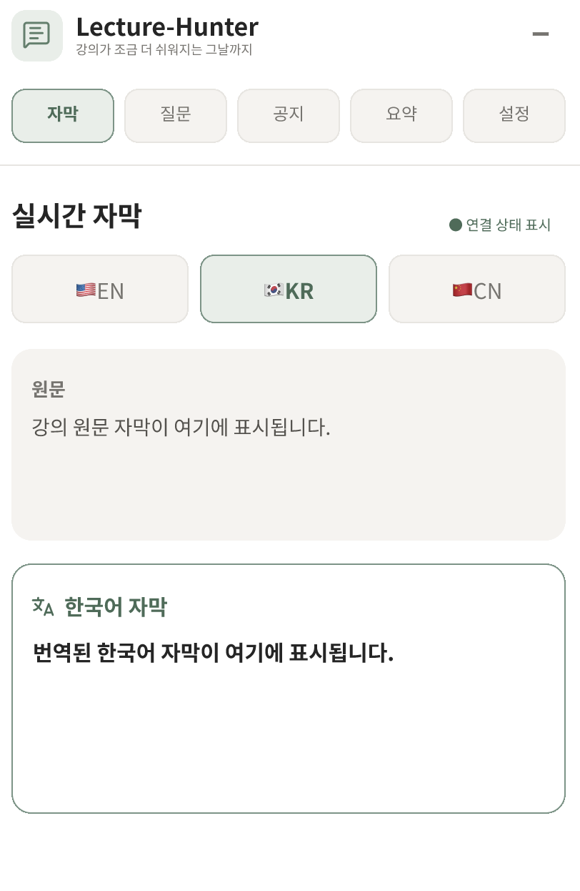
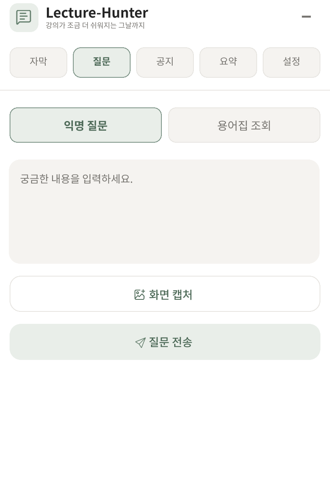
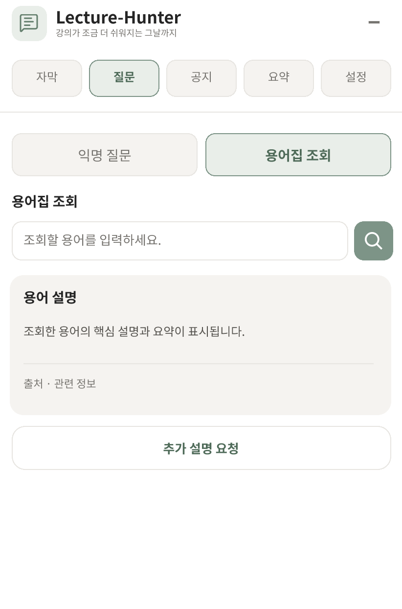
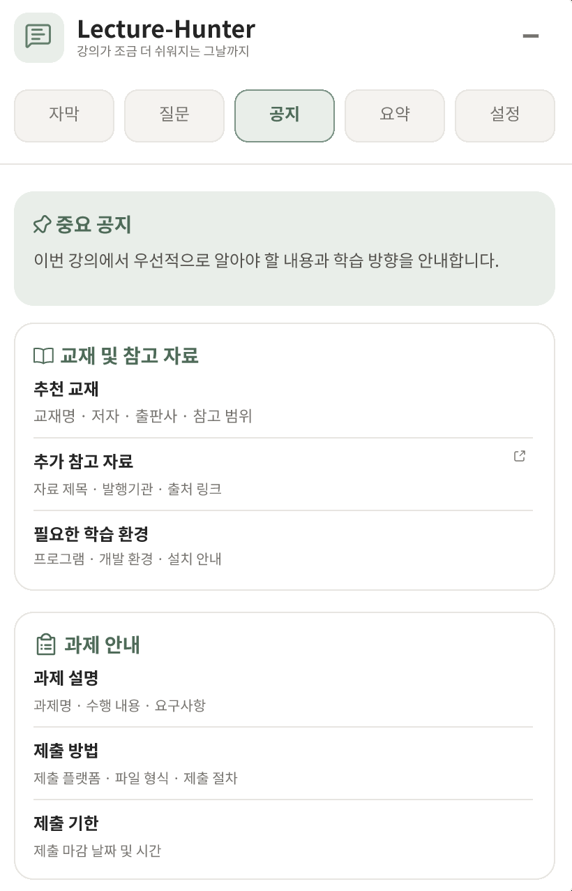
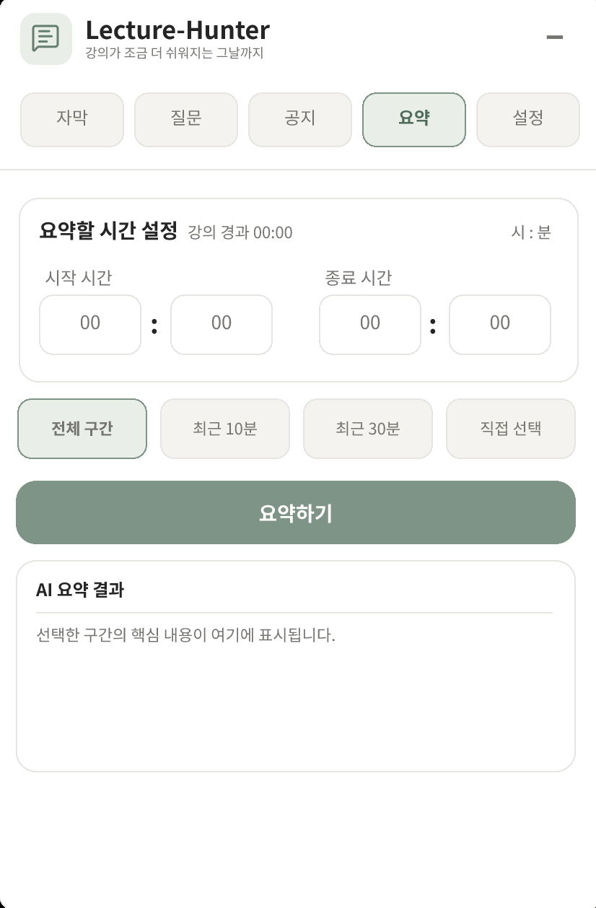
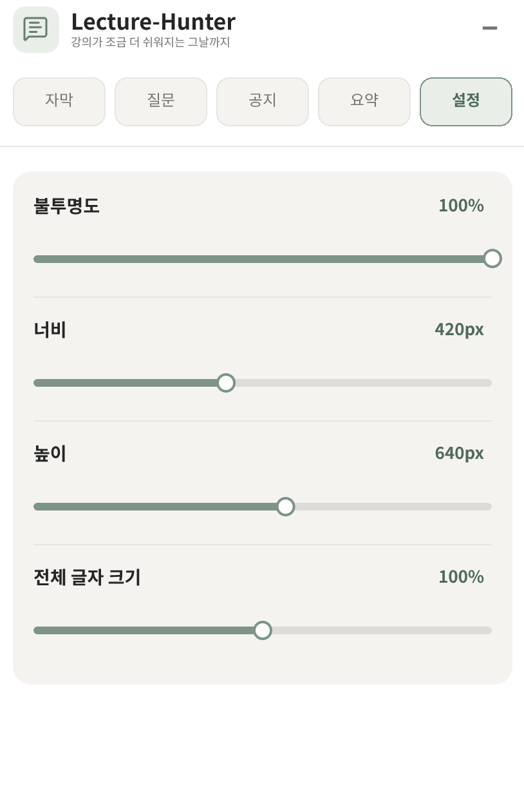

<p align="center">
  
</p>

<p align="center">
  
  
  
  
  
  
</p>

<p align="center">
  <b>Frontend</b><br/>
  <b>강의 상호작용을 위한 Flutter 기반 실시간 자막·질문 위젯 개발</b>
</p>

> [!IMPORTANT]
> 이 저장소의 `Frontend` 폴더는 **LiveLectureAI의 학생용 Flutter 프론트엔드 위젯 앱**을 다룹니다.  
> 백엔드 서버, STT/LLM 모델, 데이터베이스 구성은 `App` 폴더 또는 백엔드 문서를 참고해 주세요.

---

### 📺 프론트엔드가 하는 일

강의 화면 위에 아래 기능을 띄워주는 위젯이에요. 디자인 기준은 `docs/design/과제헌터.html` 입니다.

- 실시간 원문 자막 + 번역 자막 (EN / KR / CN)
- 교수님께 익명 질문, AI에게 질문(화면 캡처 첨부 가능), AI로 질문 다듬기
- 용어집 조회 (강의에서 나온 용어 + 없는 용어는 AI 설명)
- 강의 공지 (중요 공지 / 교재 및 참고 자료 / 과제 안내, 기본 내용은 `App/sql/003_sample_notices.sql`)
- 구간 요약 (전체 / 최근 10분 / 최근 30분 / 직접 선택)
- 위젯 투명도·너비·높이·글자 크기 설정, 최소화

---

### ✨ 기능 현황

| 기능 | 상태 |
|------|------|
| 실시간 자막 · 번역 언어 전환 | ✅ 완료 |
| 교수님께 익명 질문 · 질문 목록 | ✅ 완료 |
| AI 질문 · 화면 캡처(VLM) · 새 대화 | ✅ 완료 |
| AI 질문 다듬기 | ✅ 완료 |
| 용어집 조회 · 추가 설명 | ✅ 완료 |
| 강의 공지 | ✅ 완료 |
| 구간 요약 | ✅ 완료 |
| 위젯 설정 · 최소화 | ✅ 완료 |
| Supabase Realtime 수신 (끊기면 폴링으로 대체) | ✅ 완료 |
| 단독 실행 오디오 연결 (유튜브 주소 / 마이크 / 탭·화면 오디오) | ✅ 완료 |
| 크롬 확장 연동 (크기·최소화·드래그, 탭 오디오 상태, 탭 화면 캡처) | ✅ 완료 · [Extension/README.md](../Extension/README.md) |

---

### 🖼 화면 미리보기

<table align="center">
  <tr>
    <th align="center">🎙 실시간 자막 및 번역</th>
    <th align="center">💬 강의 AI 질문</th>
  </tr>
  <tr>
    <td align="center">
      
      <br/>
      <sub>강의 원문과 한국어 자막을 함께 확인할 수 있어요.</sub>
    </td>
    <td align="center">
      
      <br/>
      <sub>강의 내용에 대해 질문하고 화면을 캡처해 보낼 수 있어요.</sub>
    </td>
  </tr>
  <tr>
    <th align="center">📚 용어집 조회</th>
    <th align="center">📢 강의 공지</th>
  </tr>
  <tr>
    <td align="center">
      
      <br/>
      <sub>강의 용어를 입력해 용어집에서 찾아볼 수 있어요.</sub>
    </td>
    <td align="center">
      
      <br/>
      <sub>강의 공지와 자료, 과제 안내를 확인할 수 있어요.</sub>
    </td>
  </tr>
  <tr>
    <th align="center">📝 강의 요약</th>
    <th align="center">⚙️ 설정</th>
  </tr>
  <tr>
    <td align="center">
      
      <br/>
      <sub>원하는 구간의 강의 내용을 요약하고 주요 타임라인을 확인할 수 있어요.</sub>
    </td>
    <td align="center">
      
      <br/>
      <sub>자막 창의 투명도, 너비, 높이와 글자 크기를 조절할 수 있어요.</sub>
    </td>
  </tr>
</table>


---

### 🚀 시작하는 방법

**사전 준비** _(딱 한 번만)_

| 필요한 것 | 받는 곳 |
|---------|---------|
| Flutter 3.x | https://docs.flutter.dev/get-started/install |
| Chrome 브라우저 | https://www.google.com/chrome/ |

**설치 및 실행**

```bash
# 1. 프로젝트 받기
git clone https://github.com/2022764025/Lecture-Hunter.git
cd Lecture-Hunter/Frontend

# 2. 패키지 설치 (부품 자동으로 내려받기)
flutter pub get

# 3. env.json 만들기 (아래 "환경 변수" 참고, Frontend 폴더 바로 아래)

# 4-a. 개발 실행 (코드 고치면 r 로 다시 불러오기)
#      크롬 확장으로 쓸 때: 평소 크롬에서 확장이 이 주소를 띄운다
flutter run -d web-server --web-port=9998 --web-hostname=127.0.0.1 --dart-define-from-file=env.json
#      확장 없이 디버그 크롬 창으로 바로 보기
flutter run -d chrome --web-port=9998 --dart-define-from-file=env.json

# 4-b. 또는 빌드해서 띄우기 (크롬 확장으로 쓸 때 권장)
flutter build web --dart-define-from-file=env.json
cd build/web && python3 -m http.server 9998 --bind 127.0.0.1
```

**env.json 예시**

```json
{
  "API_BASE_URL": "http://127.0.0.1:8000",
  "WS_BASE_URL": "ws://127.0.0.1:8000",
  "SUPABASE_URL": "https://<프로젝트>.supabase.co",
  "SUPABASE_ANON_KEY": "sb_publishable_..."
}
```

> 💡 `SUPABASE_URL`과 `SUPABASE_ANON_KEY`는
> [Supabase 사이트](https://supabase.com/dashboard) → 내 프로젝트
> → **Project Settings → API** 에서 복사해요.

`http://127.0.0.1:9998` 을 열면 어두운 화면 가운데에 위젯과 **강의 연결** 패널이 보여요.
유튜브 주소를 넣고 **강의 시작**을 누르면 서버가 영상 음성을 받아 자막을 만듭니다. 마이크, 탭·화면 오디오도 고를 수 있어요.

**주소창 옵션**

| 옵션 | 설명 |
|------|------|
| `?lecture_id=...` | 이미 진행 중인 강의를 봅니다 (오디오는 크롬 확장 등 다른 곳에서 보냄) |
| `?tab=caption\|question\|notice\|summary\|settings` | 처음 열 탭 |
| `?sub=glossary` | 질문 탭에서 용어집을 먼저 엽니다 |
| `?minimized=1` | 최소화한 상태로 시작 |

---

### 🔧 환경 변수

설정 파일: `lib/core/config/app_config.dart`

| 변수명 | 설명 | 예시 |
|--------|------|------|
| `API_BASE_URL` | 백엔드 REST API 주소 | `http://127.0.0.1:8000` |
| `WS_BASE_URL` | 백엔드 WebSocket 주소 | `ws://127.0.0.1:8000` |
| `SUPABASE_URL` | Supabase 프로젝트 URL | `your_supabase_url` |
| `SUPABASE_ANON_KEY` | 브라우저용 Supabase key (publishable / anon) | `sb_publishable_...` |
| `LECTURE_ID` | (선택) 주소창에 `lecture_id`가 없을 때 볼 강의 ID | `demo-lecture` |
| `TARGET_LANG` | (선택) 기본 번역 언어 `ko` / `en` / `zh` / `ja` | `ko` |

> [!IMPORTANT]
> `service_role` 키는 프론트에 절대 사용 금지. anon public key만 사용.

---

### 📁 프로젝트 구조

```text
Frontend/
├── web/index.html            # window.llaiAudio (마이크·탭 오디오·유튜브 → 백엔드 WebSocket)
├── assets/fonts/pretendard/  # Pretendard 글꼴 (OFL, LICENSE.txt 포함)
├── docs/design/과제헌터.html  # 디자인 기준
├── lib/
│   ├── main.dart
│   ├── core/
│   │   ├── config/           # env.json 값 (AppConfig)
│   │   ├── theme/            # 색·글자 크기 토큰 (디자인의 CSS 변수)
│   │   └── web/              # 크롬 확장 iframe 메시지, 화면 캡처, 오디오 연결
│   ├── models/               # 자막·질문·공지·용어·요약 모델, 언어
│   ├── services/             # REST API, Supabase Realtime(+폴링), 로컬 저장
│   ├── shared/ui.dart        # 공통 버튼·카드·입력창
│   └── features/
│       ├── session/          # 강의 ID, 오디오 연결 상태, 강의 진행 상태
│       ├── overlay/          # 위젯 틀(헤더·탭·최소화), 단독 실행 화면
│       ├── caption/          # 자막 탭
│       ├── question/         # 질문 탭 (교수님께 / AI에게)
│       ├── glossary/         # 용어집 조회
│       ├── notice/           # 공지 탭
│       ├── summary/          # 요약 탭
│       └── settings/         # 설정 탭
├── pubspec.yaml
└── README.md
```

---

<details>
<summary>🧪 개발 명령어</summary>

**패키지 설치**
```bash
flutter pub get
```

**코드 정리**
```bash
dart format .
```

**정적 분석**
```bash
flutter analyze
```

**Web 실행**
```bash
flutter run -d chrome
```

**Web 빌드**
```bash
flutter build web
```

</details>

---

<details>
<summary>🧩 테스트 방법</summary>

**위젯이 쓰는 API 엔드포인트**

| 기능 | 엔드포인트 |
|------|-----------|
| 강의 진행 상태 | `GET /lecture/status?lecture_id=` |
| 강의 종료 (전체 요약 저장) | `POST /lecture/end?lecture_id=` |
| 번역 언어 바꾸기 | `PUT /lecture/settings` `{lecture_id, target_lang}` |
| AI 질문 | `POST /lecture/ask` `{lecture_id, question, target_lang, client_id}` |
| 새 대화 | `POST /lecture/ask/reset?lecture_id=&client_id=` |
| 화면 캡처 질문 | `POST /api/vlm/analyze` `{lecture_id, image, question, target_lang}` |
| 익명 질문 등록 / 목록 | `POST` · `GET /lecture/questions` |
| AI 질문 다듬기 | `POST /lecture/questions/refine` |
| 용어집 | `GET /lecture/glossary?lecture_id=&keyword=` |
| 공지 | `GET /lecture/notices?lecture_id=` |
| 요약 | `GET /lecture/summary/full` · `/adaptive?minutes=` · `/range?start_min=&end_min=` |
| 오디오 WebSocket | `ws://127.0.0.1:8000/ws/audio/{lecture_id}?target_lang=ko` (PCM16 16kHz, 유튜브는 `&youtube=주소`) |

**Supabase Realtime (postgres_changes, schema `public`)**

| 테이블 | 이벤트 | 용도 |
|--------|--------|------|
| `lecture_contents` | INSERT / UPDATE | 자막 (원문을 먼저 넣고 번역을 UPDATE) |
| `lecture_questions` | INSERT / UPDATE / DELETE | 익명 질문 목록 |
| `lecture_notices` | INSERT / UPDATE / DELETE | 공지 (강의별 + 전체 공지) |
| `lecture_glossary` | INSERT | 강의에서 나온 용어 |

Realtime이 연결되지 않으면 위젯이 REST 폴링으로 바꿔서 계속 받아옵니다.

</details>

---

<p align="center">
  <sub>🎓 강의가 조금 더 쉬워지는 그날까지</sub>
</p>
