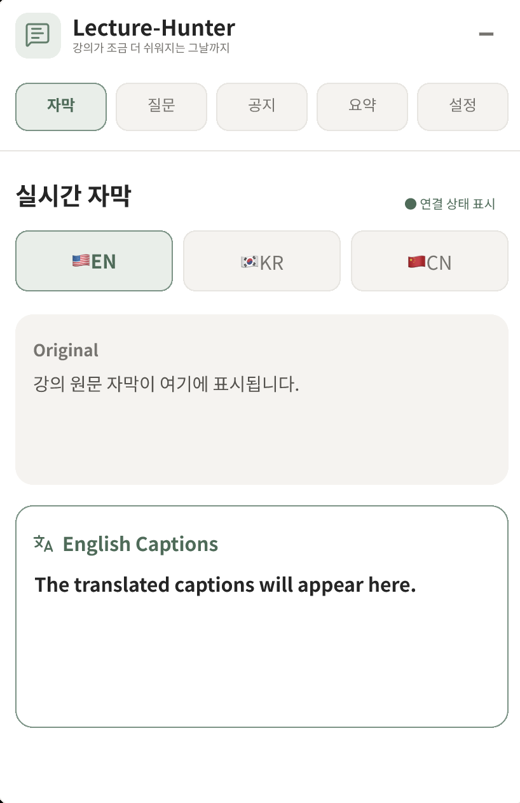
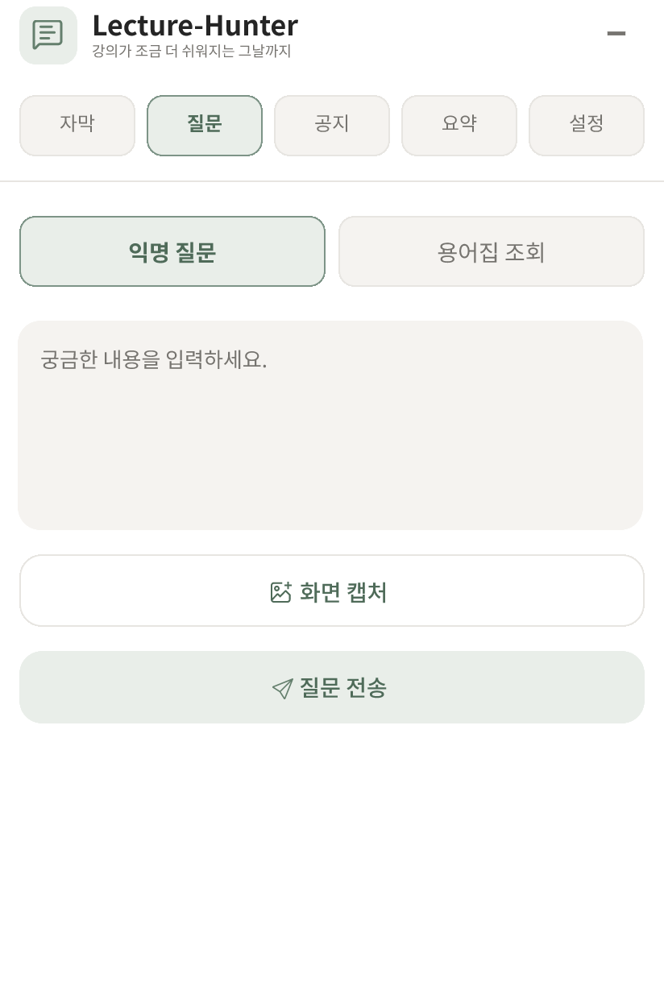
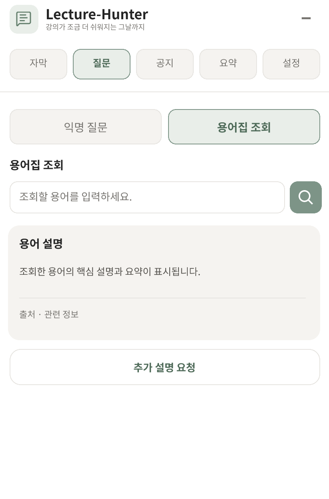
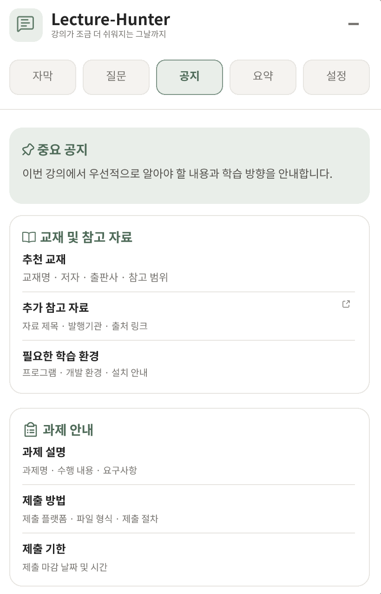
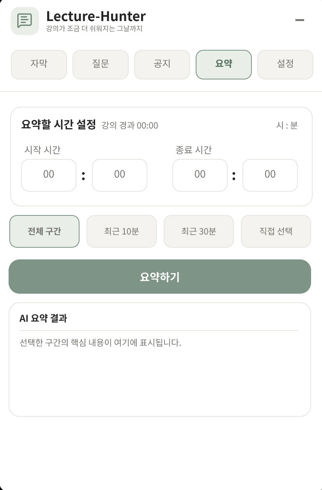
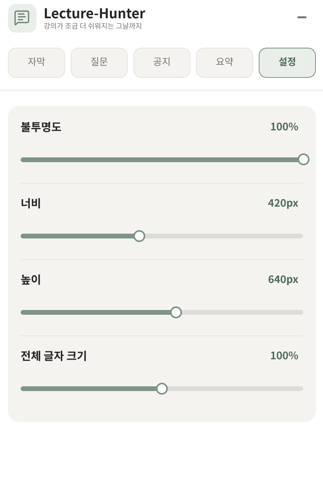

<p align="center">
  
</p>

<p align="center">
  <a href="#-getting-started"></a>
  <a href="#-example-use-case"></a>
  <br/>
  
  
  
  
  
</p>

<p align="center"><b>Developing a Flutter-Based Real-Time Captioning and Q&A Widget for Interactive Lectures</b></p>

<p align="center">
  <a href="README.md">🇰🇷 한국어</a> &nbsp;·&nbsp;
  🇺🇸 English &nbsp;·&nbsp;
  <a href="README.zh.md">🇨🇳 简体中文</a>
</p>

> [!NOTE]
> Dong-A University, Department of Artificial Intelligence — Practical AI Development Project  
> **Team Assignment Hunter | An Suji · Lee Minjae · Koo Jaewon**

---

### 📺 What Is This Project?

We developed a **Flutter-based real-time captioning and Q&A widget for interactive lectures**.

It lets students follow captions and ask questions while attending lectures. Without leaving the lecture screen, they can also use translation, anonymous questions, glossary search, announcements, and lecture summaries.

### 🤔 What Is Flutter?

Flutter is a development tool for building **applications that run in multiple environments using a single codebase**.

> 💡 **TIP**  
> If you feel uncomfortable raising your hand, use anonymous questions. You can also look up unfamiliar terms directly from the same question screen.

---

### 📚 Table of Contents

* [When Is It Useful?](#-when-is-it-useful)
* [How Is It Different from Existing Learning Tools?](#-how-is-it-different-from-existing-learning-tools)
* [Key Features](#-key-features)
* [Example Use Case](#-example-use-case)
* [How Does It Work?](#-how-does-it-work)
* [Getting Started](#-getting-started)
* [How to Use It](#-how-to-use-it)
* [Technology Stack](#-technology-stack)
* [Project Structure](#-project-structure)
* [References](#references)

---

### 🙋 When Is It Useful?

| If you're thinking... | Here's how it helps |
|---|---|
| “I can't understand this lecture in English...” | Korean translated captions help you follow along. |
| “The professor is speaking too fast...” | Review what you missed through captions. |
| “I'm 10 minutes late. What's happening now?” | Select a time range to get a lecture summary. |
| “I want to ask something, but I'm shy...” | Send a question anonymously. |
| “I heard an unfamiliar term and want to check it...” | Look it up using the glossary in the Questions tab. |
| “What were the assignment submission instructions?” | Find assignment details and submission instructions in the Announcements tab. |
| “I missed an important announcement or lecture material...” | Check announcements and materials in the Announcements tab. |

---

### ✨ How Is It Different from Existing Learning Tools?

**Works across different lecture environments.**  
Instead of being tied to a specific lecture website, the widget appears on top of the lecture screen.

**No need to leave the lecture screen.**  
Access captions, questions, announcements, and summaries while attending a lecture.

**Provides real-time captions and translation.**  
The professor's speech appears as captions, and you can select English, Korean, or Chinese as the translation language.

**Supports anonymous questions and glossary lookup.**  
Ask questions anonymously, attach a screenshot of the lecture screen, or search for unfamiliar terms.

**Summarizes the parts of a lecture you need.**  
Summarize the last 5 minutes, the last 10 minutes, or a time range of your choice.

**Lets you customize the widget.**  
Change its position, size, text size, and opacity.

---

### 🖼 Key Features

<table align="center">
  <tr><th align="center">🎙 Real-Time Captions and Translation</th><th align="center">💬 AI Lecture Questions</th></tr>
  <tr>
    <td align="center"><br/><sub>View the original lecture text alongside captions translated into your selected language (English, Korean, or Chinese).</sub></td>
    <td align="center"><br/><sub>Ask questions anonymously and attach screenshots of the lecture screen.</sub></td>
  </tr>
  <tr><th align="center">📚 Glossary Lookup</th><th align="center">📢 Lecture Announcements</th></tr>
  <tr>
    <td align="center"><br/><sub>Look up technical terms and explanations through the glossary in the Questions tab.</sub></td>
    <td align="center"><br/><sub>Check lecture announcements, materials, and assignment information.</sub></td>
  </tr>
  <tr><th align="center">📝 Lecture Summaries</th><th align="center">⚙️ Settings</th></tr>
  <tr>
    <td align="center"><br/><sub>Summarize a selected part of the lecture and view its key timeline.</sub></td>
    <td align="center"><br/><sub>Adjust the caption widget's opacity, width, height, and text size.</sub></td>
  </tr>
</table>

---

### 💡 Example Use Case

**Scenario: A lecture conducted in English**

```text
Professor:
"Now let's discuss the vanishing gradient problem."

On-screen captions:
Original: Now let's discuss the vanishing gradient problem.
Translation: 이제 기울기 소실 문제에 대해 다뤄보겠습니다.

Glossary lookup:
Vanishing gradient

Search result:
Vanishing Gradient

A phenomenon in which learning becomes difficult as a neural network
gets deeper because training signals do not propagate effectively
back to earlier layers.
```

<br>

## 🔄 How Does It Work?

> **Microphone audio → Speech recognition and translation → Captions displayed in the widget**

```text
1️⃣  The professor speaks.
       ↓
2️⃣  AI converts speech into text.
    (And translates it into the selected language.)
       ↓
3️⃣  Captions appear on your screen.
       ↓
4️⃣  Have a question? → Ask anonymously!
    Missed part of the lecture? → Click the Summary button!
```

<br/>

## 🚀 Getting Started

> Open three terminal windows before starting!

---

### STEP 0. Prerequisites *(One-Time Setup)*

| Software | Download |
|---|---|
| Python 3.12 | https://www.python.org/downloads/ |
| Flutter 3.x | https://docs.flutter.dev/get-started/install |
| Ollama | https://ollama.com/ |
| Google Chrome | https://www.google.com/chrome/ |
| Supabase account | https://supabase.com/ |

---

### STEP 1. Clone the Project

```bash
git clone https://github.com/2022764025/Lecture-Hunter.git
cd Lecture-Hunter
```

---

### STEP 2. Set Up the Backend *(One-Time Setup)*

```bash
python3 -m venv pikmin
source pikmin/bin/activate        # Windows: pikmin\Scripts\activate
pip install -r requirements.txt
cp .env.example .env              # Open .env and fill in the values below
```

```env
SUPABASE_URL=enter_your_value_here
SUPABASE_ANON_KEY=enter_your_value_here
LLM_MODEL=gemma2:2b
VLM_MODEL=llama3.2-vision:11b
WHISPER_MODEL_SIZE=medium
WHISPER_DEVICE=auto
VAD_THRESHOLD=0.3
```

> 💡 Find your URL and key in the Supabase Dashboard → Project Settings → API.

---

### STEP 3. Set Up the Frontend *(One-Time Setup)*

```bash
cd Frontend && flutter pub get && cd ..
```

---

### STEP 4. Run the Project

**Terminal 1** — AI Server

```bash
ollama serve
```

**Terminal 2** — Backend

```bash
source pikmin/bin/activate
cd App && uvicorn main:app --reload
```

**Terminal 3** — Frontend

```bash
cd Frontend
flutter run -d chrome \
  --web-port=9998 \
  --dart-define=API_BASE_URL=http://127.0.0.1:8000 \
  --dart-define=WS_BASE_URL=ws://127.0.0.1:8000 \
  --dart-define=SUPABASE_URL=enter_your_value_here \
  --dart-define=SUPABASE_ANON_KEY=enter_your_value_here \
  --dart-define=LECTURE_ID=demo-lecture \
  --dart-define=TARGET_LANG=Korean
```

---

### STEP 5. Install the Chrome Extension

1. Enter `chrome://extensions` in Chrome's address bar.
2. Enable **Developer mode** in the upper-right corner.
3. Click **Load unpacked** and select the `Extension/` folder.
4. Click the 🧩 icon and pin Lecture Hunter.
5. Click the extension icon on the lecture tab to launch the widget.

---

### ✅ Verify That It Works

| Component | Address / Check |
|---|---|
| Backend | http://127.0.0.1:8000 |
| Frontend | http://127.0.0.1:9998 |
| Extension | Check whether the widget appears over the lecture tab. |

<br>

---

## 🧭 How to Use It

Once the Flutter app starts, the learning assistant widget appears on top of the lecture screen.
Just click the buttons to explore its features!

| Feature | How to Use It |
|---|---|
| View captions | See the original text and captions translated into your selected language. |
| Ask a question | Write and send an anonymous question in the Questions tab. |
| Start a new question | Clear the previous question to start again. |
| Search for terms | Switch to Glossary Lookup in the Questions tab and search. |
| Check announcements | View lecture announcements, materials, assignment details, and submission instructions. |
| Summarize a time range | Select start and end times to view an AI summary and key timeline. |
| Settings | Adjust the widget's opacity, width, height, and text size. |

<br/>

---

## 🛠 Technology Stack

| Area | Technology | Why We Use It |
|---|---|---|
| Interface | Flutter | To build the captions, questions, announcements, summaries, and settings screens. |
| Server | FastAPI | To connect the AI system and user interface. |
| AI model runtime | Ollama | To run AI models locally without an internet connection. |
| Speech recognition | Faster-Whisper | To convert the professor's speech into text. |
| Voice activity detection | Silero VAD | To identify segments containing speech. |
| Data storage | Supabase | To store lecture content and caption data. |
| Real-time delivery | Supabase Realtime | To deliver captions to the screen in real time. |
| Audio connection | WebSocket | To send microphone audio to the server. |

<br/>

---

## 📁 Project Structure

```text
Lecture-Hunter/
├── App/
│   ├── api/
│   ├── core/
│   ├── services/
│   └── main.py
├── Extension/
│   ├── background.js
│   ├── manifest.json
│   ├── offscreen.html
│   └── offscreen.js
├── Frontend/
│   ├── lib/
│   ├── web/
│   └── pubspec.yaml
├── assets/
├── Dockerfile
├── requirements.txt
└── README.md
```

<br/>

---

### References

- Flutter Documentation: https://docs.flutter.dev/
- FastAPI Documentation: https://fastapi.tiangolo.com/
- Supabase Documentation: https://supabase.com/docs
- Ollama Documentation: https://ollama.com/
- Faster-Whisper GitHub: https://github.com/SYSTRAN/faster-whisper

---

<p align="center"><sub>🎓 Until the Day Learning Becomes Easier</sub></p>
