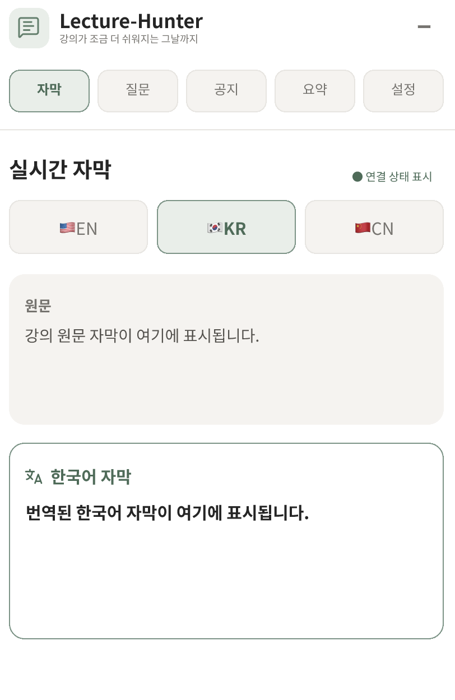
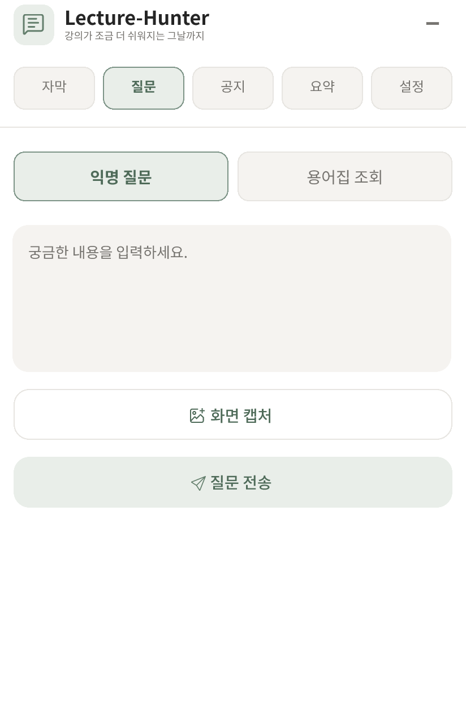
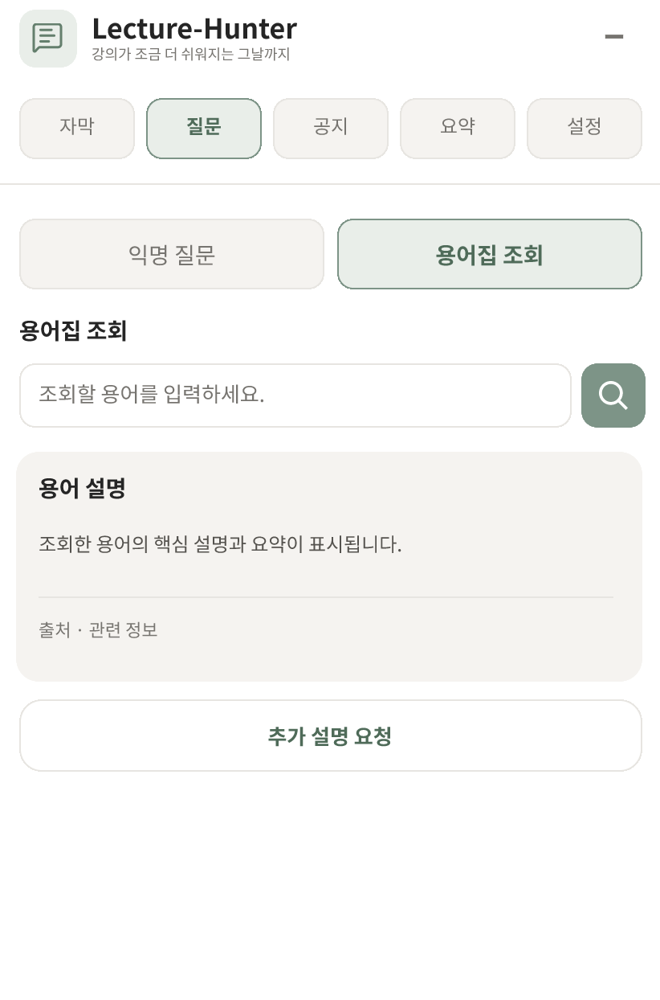
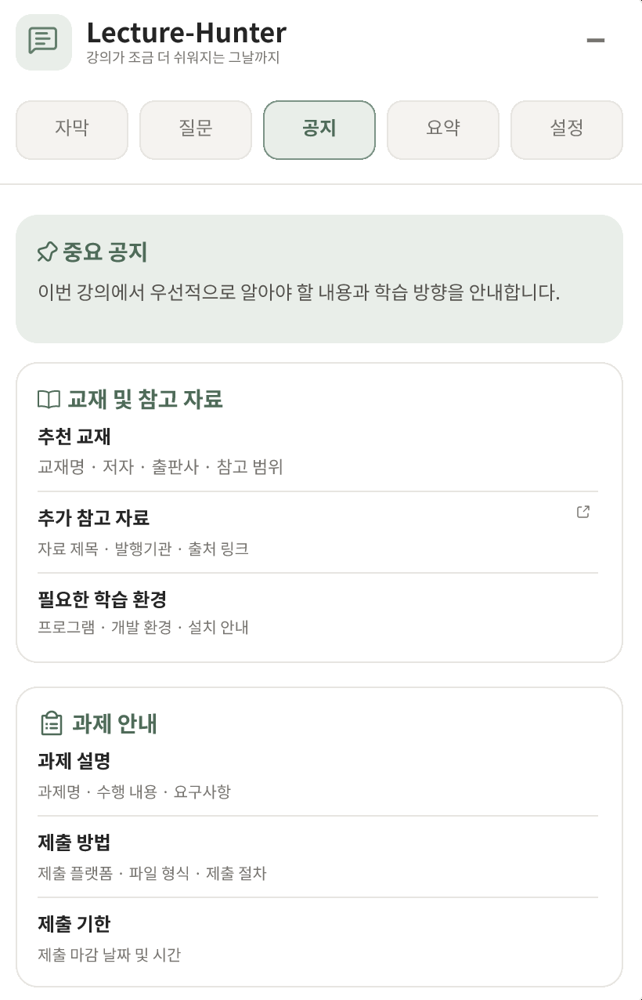
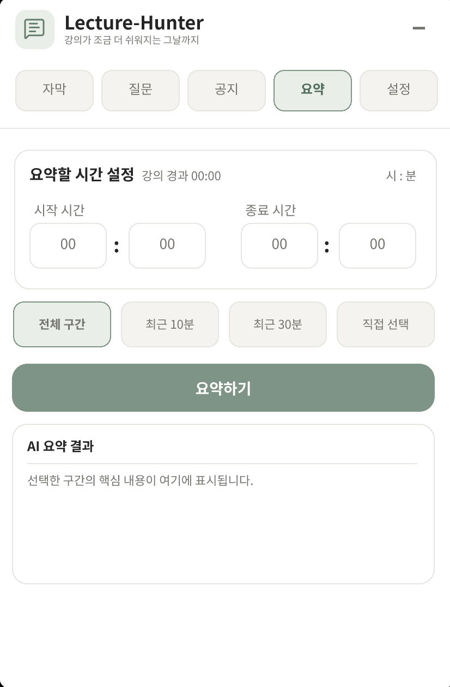
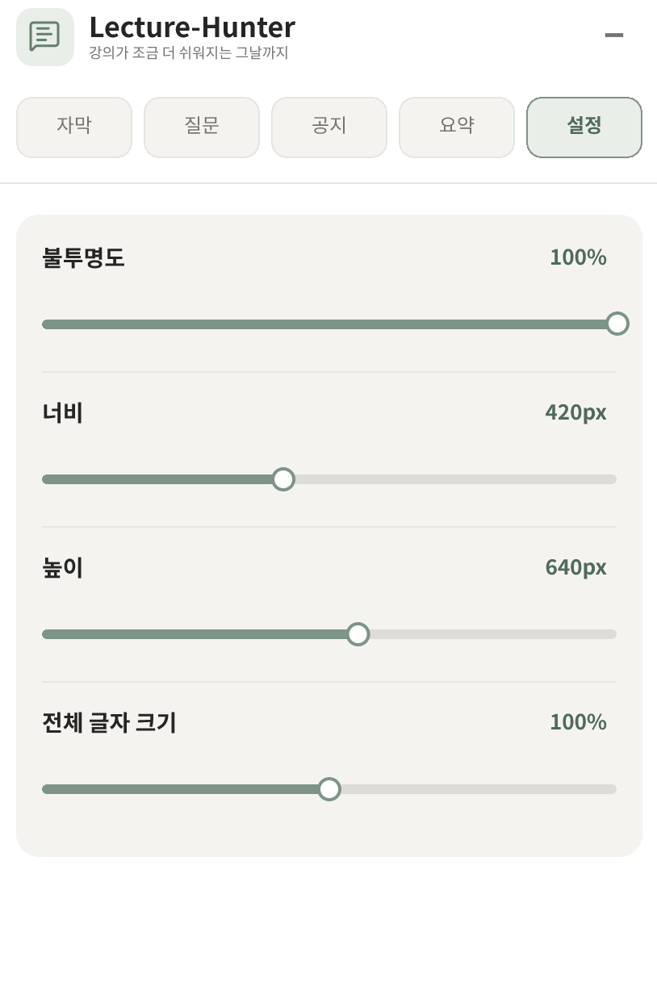

<p align="center">
  
</p>

<p align="center">
  <a href="#-시작하기">
    
  </a>
  <a href="#-사용-예시">
    
  </a>
  <br/>
  
  
  
  
  
</p>

<p align="center">
  <b>강의 상호작용을 위한 Flutter 기반 실시간 자막·질문 위젯 개발</b>
</p>

<p align="center">
  🇰🇷 한국어 &nbsp;·&nbsp;
  <a href="README.en.md">🇺🇸 English</a> &nbsp;·&nbsp;
  <a href="README.zh.md">🇨🇳 简体中文</a>
</p>

> [!NOTE]
> 동아대학교 AI학과 실증적AI개발프로젝트  
> **과제헌터 팀 | 안수지 · 이민재 · 구재원**
### 🔗 Links
[](https://app.notion.com/p/AI-I-1-325a24cae47280e19ab6f3d52c2482ca?source=copy_link)
[](https://app.notion.com/p/AI-II-2-3e3a24cae472800bb544fdfd804a26f0?source=copy_link)
[](https://www.figma.com/proto/YVSoQ9JNaM6womrJxa0Z1A/%EA%B3%BC%EC%A0%9C%ED%97%8C%ED%84%B0?node-id=1-539&p=f&t=wnxObpo5nAsxIZ4W-1&scaling=min-zoom&content-scaling=fixed&page-id=0%3A1)

---

### 📺 이 프로젝트가 뭔가요?

우리는 **강의 상호작용을 위한 Flutter 기반 실시간 자막·질문 위젯**을 개발했어요.

강의를 들으면서 자막을 확인하고 궁금한 내용을 바로 질문할 수 있도록 만들었어요. 강의 화면을 벗어나지 않고 번역, 익명 질문, 용어 검색, 공지 확인, 강의 요약 기능도 이용할 수 있어요.

### 🤔 Flutter가 뭔가요?

Flutter는 **하나의 코드로 여러 환경에서 실행되는 프로그램**을 만들 수 있는 개발 도구예요.

> 💡 **TIP**  
> 손들고 질문하기 부담스러울 때는 익명 질문을 이용하고, 어려운 용어는 같은 질문 화면에서 바로 조회할 수 있어요.

---

### 📚 목차

* [이런 상황에서 유용해요](#-이런-상황에서-유용해요)
* [기존 학습 보조 도구와 무엇이 다른가요?](#-기존-학습-보조-도구와-무엇이-다른가요)
* [주요 기능 미리보기](#-주요-기능-미리보기)
* [사용 예시](#-사용-예시)
* [어떻게 작동하나요?](#-어떻게-작동하나요)
* [시작하는 방법](#-시작하는-방법)
* [어떻게 사용하나요?](#-어떻게-사용하나요)
* [어떤 기술로 만들었나요?](#-어떤-기술로-만들었나요)
* [프로젝트 구조](#-프로젝트-구조)
* [참고 자료](#참고-자료)

---

### 🙋 이런 상황에서 유용해요

| 이런 상황이라면...                  | 이렇게 도와줘요    |
| ---------------------------- | --------------------------- |
| “영어 강의라 하나도 못 알아듣겠어...”      | 한국어 번역 자막으로 이해를 도와줘요.       |
| “교수님이 너무 빠르게 말씀하셔...”        | 놓친 내용을 자막으로 다시 확인할 수 있어요.   |
| “10분 늦게 들어왔는데 지금 무슨 얘기야...”  | 원하는 시간 구간을 지정해 강의 요약을 확인할 수 있어요.   |
| “질문하고 싶은데 손들기 부끄러워...”       | 익명으로 질문을 보낼 수 있어요.         |
| “어려운 단어가 나왔는데 다시 확인하고 싶어...” | 질문 탭에서 용어집을 조회할 수 있어요.  |
| “교수님이 말씀하신 과제 제출 방법이 뭐였지?” | 공지 탭에서 과제 설명과 제출 방법을 확인할 수 있어요. |
| “강의 자료나 중요한 공지를 놓쳤어...” | 공지 탭에서 강의 공지와 자료를 확인할 수 있어요. |

---

### ✨ 기존 학습 보조 도구와 무엇이 다른가요?

**다양한 강의 환경에서 사용할 수 있어요.**  
특정 강의 사이트에 종속되지 않고, 강의 화면 위에 위젯을 띄워 사용할 수 있어요.

**강의 화면을 벗어나지 않아도 돼요.**  
자막, 질문, 공지, 요약 기능을 강의를 들으면서 이용할 수 있어요.

**실시간 자막과 번역을 제공해요.**  
교수님의 음성을 자막으로 보여주고 영어, 한국어, 중국어 중 번역 언어를 선택할 수 있어요.

**익명 질문과 용어집 조회가 가능해요.**  
궁금한 내용을 익명으로 질문하고, 강의 화면을 캡처해 첨부하거나 어려운 용어를 검색할 수 있어요.

**필요한 강의 내용만 요약할 수 있어요.**  
최근 5분, 최근 10분 또는 원하는 시간 구간을 선택해 강의 내용을 요약할 수 있어요.

**위젯을 원하는 대로 조절할 수 있어요.**  
위치와 크기를 변경하고 글자 크기와 투명도를 조절할 수 있어요.

---

### 🖼 주요 기능

<table align="center">
  <tr>
    <th align="center">🎙 실시간 자막 및 번역</th>
    <th align="center">💬 강의 AI 질문</th>
  </tr>
  <tr>
    <td align="center">
      
      <br/>
      <sub>강의 원문과 선택한 언어(영어, 한국어, 중국어)의 번역 자막을 함께 확인할 수 있어요.</sub>
    </td>
    <td align="center">
      
      <br/>
      <sub>익명으로 질문하고 강의 화면을 캡처해 첨부할 수 있어요.</sub>
    </td>
  </tr>
  <tr>
    <th align="center">📚 용어집 조회</th>
    <th align="center">📢 강의 공지</th>
  </tr>
  <tr>
    <td align="center">
      
      <br/>
      <sub>질문 탭의 용어집 조회에서 전문 용어와 설명을 확인할 수 있어요.</sub>
    </td>
    <td align="center">
      
      <br/>
      <sub>강의 공지와 자료, 과제 안내를 확인할 수 있어요.</sub>
    </td>
  </tr>
  <tr>
    <th align="center">📝 강의 요약</th>
    <th align="center">⚙️ 설정</th>
  </tr>
  <tr>
    <td align="center">
      
      <br/>
      <sub>원하는 구간의 강의 내용을 요약하고 주요 타임라인을 확인할 수 있어요.</sub>
    </td>
    <td align="center">
      
      <br/>
      <sub>자막 창의 투명도, 너비, 높이와 글자 크기를 조절할 수 있어요.</sub>
    </td>
  </tr>
</table>


---


### 💡 사용 예시

**상황: 영어로 진행되는 수업**

```text
교수님:
"Now let's discuss the vanishing gradient problem."

화면 자막:
원문: Now let's discuss the vanishing gradient problem.
번역: 이제 기울기 소실 문제에 대해 다뤄보겠습니다.

용어집 조회:
기울기 소실

검색 결과:
기울기 소실(Vanishing Gradient)

신경망이 깊어질수록 학습 신호가 앞쪽까지 잘 전달되지 않아 학습이 어려워지는 현상
```

<br>


## 🔄 어떻게 작동하나요?

> **마이크 음성 → 음성 인식 및 번역 → 위젯 자막 출력**


```
1️⃣  교수님이 말씀하신다
        ↓
2️⃣  AI가 목소리를 듣고 글자로 바꾼다
   (선택한 언어로 번역)
        ↓
3️⃣  내 화면에 자막으로 표시된다
        ↓
4️⃣  모르는 게 있으면?  →  익명 질문!
    강의 흐름 놓쳤으면? → 요약 버튼 클릭!
```

<br/>


## 🚀 시작하는 방법

> 터미널 창을 3개 열어두고 시작하세요!

---

### STEP 0. 사전 설치 _(최초 1회)_

| 프로그램 | 다운로드 |
|---------|---------|
| Python 3.12 | https://www.python.org/downloads/ |
| Flutter 3.x | https://docs.flutter.dev/get-started/install |
| Ollama | https://ollama.com/ |
| Google Chrome | https://www.google.com/chrome/ |
| Supabase 계정 | https://supabase.com/ |

---

### STEP 1. 프로젝트 가져오기

```bash
git clone https://github.com/2022764025/Lecture-Hunter.git
cd Lecture-Hunter
```

---

### STEP 2. 백엔드 준비 _(최초 1회)_

```bash
python3 -m venv pikmin
source pikmin/bin/activate        # Windows: pikmin\Scripts\activate
pip install -r requirements.txt
cp .env.example .env              # .env 파일 열어서 아래 값 채우기
```

```env
SUPABASE_URL=여기에_입력
SUPABASE_ANON_KEY=여기에_입력
LLM_MODEL=gemma2:2b
VLM_MODEL=llama3.2-vision:11b
WHISPER_MODEL_SIZE=medium
WHISPER_DEVICE=auto
VAD_THRESHOLD=0.3
```

> 💡 URL·KEY는 Supabase 대시보드 → Project Settings → API에서 확인

---

### STEP 3. 프론트엔드 준비 _(최초 1회)_

```bash
cd Frontend && flutter pub get && cd ..
```

---

### STEP 4. 실행하기

**터미널 1** — AI 서버
```bash
ollama serve
```

**터미널 2** — 백엔드
```bash
source pikmin/bin/activate
cd App && uvicorn main:app --reload
```

**터미널 3** — 프론트엔드
```bash
cd Frontend
flutter run -d chrome \
  --web-port=9998 \
  --dart-define=API_BASE_URL=http://127.0.0.1:8000 \
  --dart-define=WS_BASE_URL=ws://127.0.0.1:8000 \
  --dart-define=SUPABASE_URL=여기에_입력 \
  --dart-define=SUPABASE_ANON_KEY=여기에_입력 \
  --dart-define=LECTURE_ID=demo-lecture \
  --dart-define=TARGET_LANG=Korean
```

---

### STEP 5. 크롬 확장 프로그램 설치

1. Chrome 주소창에 `chrome://extensions` 입력
2. 오른쪽 위 **개발자 모드** 켜기
3. **압축해제된 확장 프로그램을 로드합니다** 클릭 → `Extension/` 폴더 선택
4. 🧩 아이콘 클릭 → Lecture Hunter 핀 고정
5. 강의 탭에서 아이콘 클릭 → 위젯 실행

---

### ✅ 실행 확인

| 확인 항목 | 주소 |
|---------|------|
| 백엔드 | http://127.0.0.1:8000 |
| 프론트엔드 | http://127.0.0.1:9998 |
| 확장 프로그램 | 강의 탭 위에 위젯 등장 여부 확인 |

<br>

---


## 🧭 어떻게 사용하나요?

Flutter 화면이 켜지면 강의 화면 위에 학습 도우미 위젯이 나타나요.
버튼 하나씩 눌러보면 바로 쓸 수 있어요!

| 기능 | 이렇게 쓰면 돼요 |
|------|-----------------|
| 자막 보기 | 원문과 선택한 언어의 번역 자막을 함께 확인해요 |
| 질문하기 | 질문 탭에서 익명 질문을 작성하고 전송해요 |
| 새 질문 시작 | 이전 질문 내용 지우고 새로 시작하고 싶을 때 눌러요 |
| 용어 검색 | 질문 탭에서 용어집 조회로 전환해 검색해요 |
| 공지 확인 | 강의 공지, 자료, 과제 설명과 제출 방법을 확인해요 |
| 구간 요약 | 시작과 종료 시간을 선택해 AI 요약과 주요 타임라인을 확인해요 |
| 설정 | 위젯 투명도, 너비, 높이, 글자 크기를 조절해요 |

<br/>

---

## 🛠 어떤 기술로 만들었나요?


| 영역 | 사용 기술 | 왜 사용했나요? |
|------|-----------|---------------|
| 화면 | Flutter | 자막, 질문, 공지, 요약, 설정 화면을 만들기 위해 사용했어요 |
| 서버 | FastAPI | AI랑 화면이 서로 대화하는 통로를 만들기 위해 사용했어요 |
| AI 모델 실행 | Ollama | 인터넷 없이도 AI를 내 컴퓨터에서 돌리기 위해 사용했어요 |
| 음성 인식 | Faster-Whisper | 교수님 목소리를 글자로 바꾸기 위해 사용했어요 |
| 음성 구간 감지 | Silero VAD | 말하는 구간만 골라내기 위해 사용했어요 |
| 데이터 저장 | Supabase | 강의 내용과 자막 데이터를 저장하기 위해 사용했어요 |
| 실시간 전송 | Supabase Realtime | 자막을 화면에 실시간으로 보내기 위해 사용했어요 |
| 오디오 연결 | WebSocket | 마이크 소리를 서버로 보내기 위해 사용했어요 |

<br/>

---

## 📁 프로젝트 구조


```text
Lecture-Hunter/
├── App/
│   ├── api/
│   ├── core/
│   ├── services/
│   └── main.py
├── Extension/
│   ├── background.js
│   ├── manifest.json
│   ├── offscreen.html
│   └── offscreen.js
├── Frontend/
│   ├── lib/
│   ├── web/
│   └── pubspec.yaml
├── assets/
├── Dockerfile
├── requirements.txt
└── README.md
```

<br/>

---

### 참고 자료

- Flutter 공식 문서: https://docs.flutter.dev/
- FastAPI 공식 문서: https://fastapi.tiangolo.com/
- Supabase 공식 문서: https://supabase.com/docs
- Ollama 공식 문서: https://ollama.com/
- Faster-Whisper GitHub: https://github.com/SYSTRAN/faster-whisper

---

<p align="center">
  <sub>🎓 강의가 더 쉬워지는 그날까지</sub>
</p>
