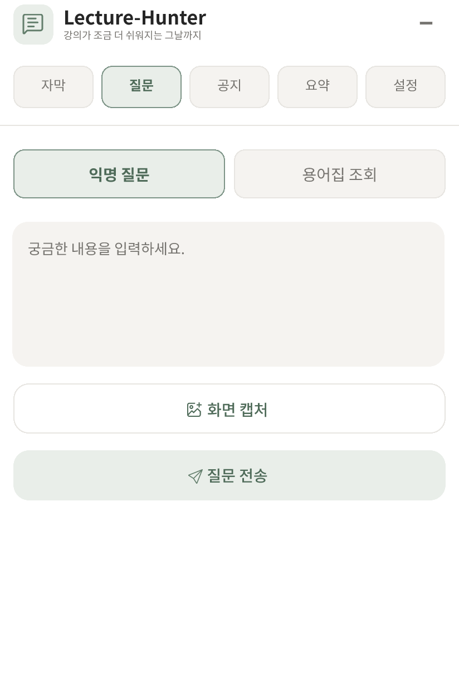
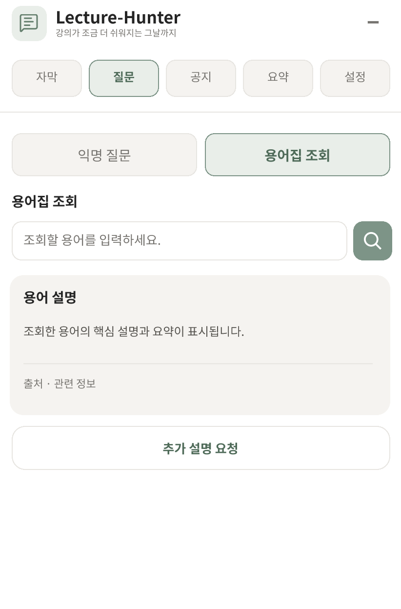
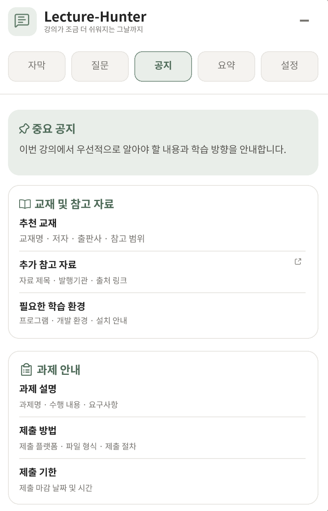
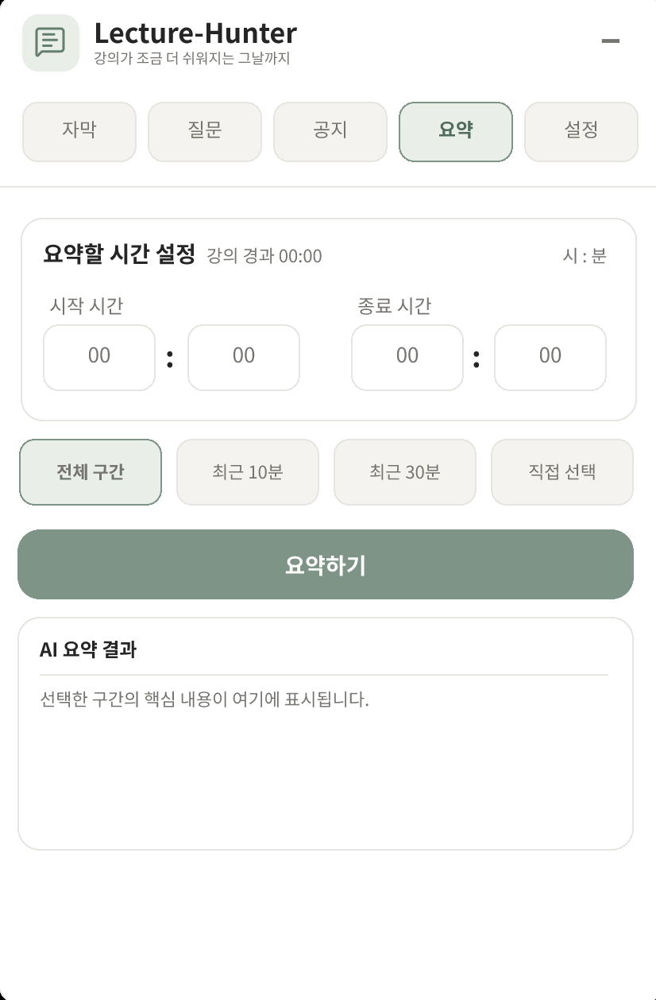
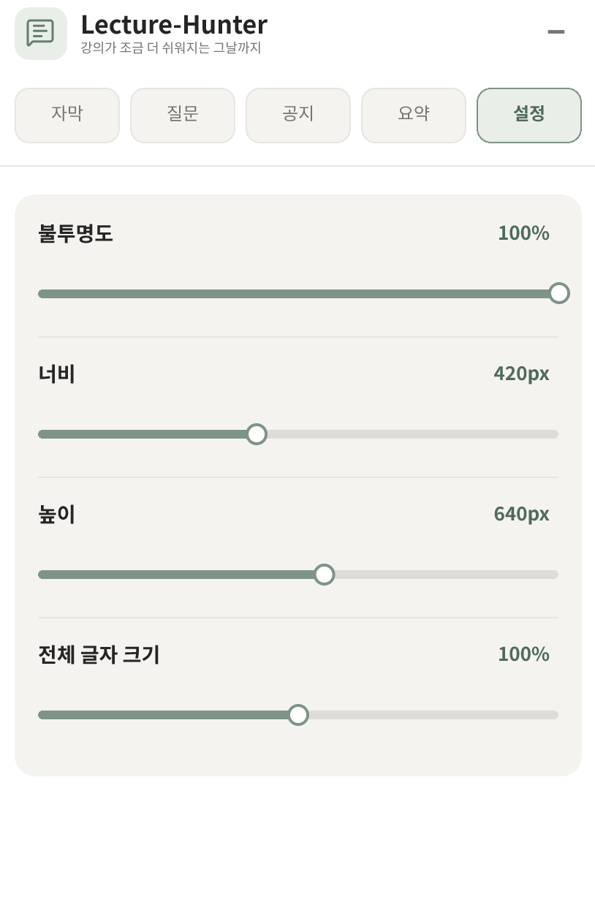

<p align="center">
  
</p>

<p align="center">
  <a href="#-快速开始"></a>
  <a href="#-使用示例"></a>
  <br/>
  
  
  
  
  
</p>

<p align="center">
  <b>基于 Flutter 的实时字幕与提问组件开发，促进课堂互动</b>
</p>

<p align="center">
  <a href="README.md">🇰🇷 한국어</a> &nbsp;·&nbsp;
  <a href="README.en.md">🇺🇸 English</a> &nbsp;·&nbsp;
  🇨🇳 简体中文
</p>

> [!NOTE]
> 东亚大学人工智能系 实证型 AI 开发项目  
> **课题猎人团队 | 安秀智 · 李敏宰 · 具在元**

---

### 📺 这是什么项目？

我们开发了一个**基于 Flutter 的实时字幕与提问组件，帮助师生在课堂上互动**。

学生可以在听课时查看字幕，并随时提出问题。无需离开课程画面，就能使用翻译、匿名提问、术语查询、公告查看和课程总结等功能。

### 🤔 什么是 Flutter？

Flutter 是一种开发工具，可以**使用同一套代码开发在不同环境中运行的应用程序**。

> 💡 **小提示**  
> 不方便举手提问时，可以使用匿名提问功能；遇到难懂的术语，也可以直接在同一提问界面中查询。

---

### 📚 目录

* [适用场景](#-适用场景)
* [与现有学习辅助工具有什么不同？](#-与现有学习辅助工具有什么不同)
* [主要功能](#-主要功能)
* [使用示例](#-使用示例)
* [工作原理](#-工作原理)
* [快速开始](#-快速开始)
* [使用方法](#-使用方法)
* [使用了哪些技术？](#-使用了哪些技术)
* [项目结构](#-项目结构)
* [参考资料](#参考资料)

---

### 🙋 适用场景

| 遇到这样的情况…… | 我们可以这样帮助你 |
|---|---|
| “英语授课，我完全听不懂……” | 通过韩语翻译字幕帮助理解课程内容。 |
| “老师讲得太快了……” | 可以通过字幕重新查看错过的内容。 |
| “迟到了 10 分钟，现在讲到哪里了？” | 可以选择指定时间段，查看课程总结。 |
| “想提问，但不好意思举手……” | 可以匿名发送问题。 |
| “刚才出现了一个难懂的术语，想再确认一下……” | 可以在提问选项卡中查询术语。 |
| “老师说的作业提交方式是什么？” | 可以在公告选项卡中查看作业说明和提交方式。 |
| “错过了课程资料或重要公告……” | 可以在公告选项卡中查看课程公告和资料。 |

---

### ✨ 与现有学习辅助工具有什么不同？

**适用于多种授课环境。**  
不依赖特定的课程网站，可以将组件悬浮显示在课程画面上。

**无需离开课程画面。**  
听课的同时就能使用字幕、提问、公告和总结功能。

**提供实时字幕与翻译。**  
将教师的语音转换为字幕，并可在英语、韩语和中文之间选择翻译语言。

**支持匿名提问与术语查询。**  
可以匿名提问、截取课程画面并附加到问题中，也可以查询难懂的术语。

**只总结需要的课程内容。**  
可以选择最近 5 分钟、最近 10 分钟，或自行指定时间段进行总结。

**可自由调整组件。**  
可以改变位置和大小，并调整字体大小与透明度。

---

### 🖼 主要功能

<table align="center">
  <tr>
    <th align="center">🎙 实时字幕与翻译</th>
    <th align="center">💬 AI 课程提问</th>
  </tr>
  <tr>
    <td align="center">
      
      <br/>
      <sub>同时查看课程原文和所选语言（英语、韩语、中文）的翻译字幕。</sub>
    </td>
    <td align="center">
      
      <br/>
      <sub>匿名提问，并可附加课程画面的截图。</sub>
    </td>
  </tr>
  <tr>
    <th align="center">📚 术语查询</th>
    <th align="center">📢 课程公告</th>
  </tr>
  <tr>
    <td align="center">
      
      <br/>
      <sub>在提问选项卡的术语查询功能中查看专业术语及其解释。</sub>
    </td>
    <td align="center">
      
      <br/>
      <sub>查看课程公告、学习资料和作业通知。</sub>
    </td>
  </tr>
  <tr>
    <th align="center">📝 课程总结</th>
    <th align="center">⚙️ 设置</th>
  </tr>
  <tr>
    <td align="center">
      
      <br/>
      <sub>总结指定时间段的课程内容，并查看主要时间线。</sub>
    </td>
    <td align="center">
      
      <br/>
      <sub>调整字幕窗口的透明度、宽度、高度和字体大小。</sub>
    </td>
  </tr>
</table>

---

### 💡 使用示例

**场景：英语授课**

```text
教师：
“Now let's discuss the vanishing gradient problem.”

屏幕字幕：
原文：Now let's discuss the vanishing gradient problem.
翻译：现在我们来讨论梯度消失问题。

术语查询：
梯度消失

查询结果：
梯度消失（Vanishing Gradient）

随着神经网络层数加深，训练信号难以有效传递到前面的网络层，从而导致模型训练困难的现象。
```

<br>

## 🔄 工作原理

> **麦克风语音 → 语音识别与翻译 → 在组件中显示字幕**

```text
1️⃣ 教师开始讲课
       ↓
2️⃣ AI 识别语音并转换为文字
   （翻译为所选语言）
       ↓
3️⃣ 字幕显示在屏幕上
       ↓
4️⃣ 遇到不懂的问题？ → 匿名提问！
   错过了课程内容？ → 点击总结按钮！
```

<br/>

## 🚀 快速开始

> 请先打开 3 个终端窗口！

---

### STEP 0. 安装必要软件（首次使用时）

| 软件 | 下载地址 |
|---|---|
| Python 3.12 | https://www.python.org/downloads/ |
| Flutter 3.x | https://docs.flutter.dev/get-started/install |
| Ollama | https://ollama.com/ |
| Google Chrome | https://www.google.com/chrome/ |
| Supabase 账号 | https://supabase.com/ |

---

### STEP 1. 获取项目

```bash
git clone https://github.com/2022764025/Lecture-Hunter.git
cd Lecture-Hunter
```

---

### STEP 2. 配置后端（首次使用时）

```bash
python3 -m venv pikmin
source pikmin/bin/activate        # Windows: pikmin\Scripts\activate
pip install -r requirements.txt
cp .env.example .env              # 打开 .env 文件并填写以下配置
```

```env
SUPABASE_URL=在此填写
SUPABASE_ANON_KEY=在此填写
LLM_MODEL=gemma2:2b
VLM_MODEL=llama3.2-vision:11b
WHISPER_MODEL_SIZE=medium
WHISPER_DEVICE=auto
VAD_THRESHOLD=0.3
```

> 💡 URL 和 KEY 可以在 Supabase 控制台 → Project Settings → API 中查看。

---

### STEP 3. 配置前端（首次使用时）

```bash
cd Frontend && flutter pub get && cd ..
```

---

### STEP 4. 启动项目

**终端 1 — AI 服务**

```bash
ollama serve
```

**终端 2 — 后端**

```bash
source pikmin/bin/activate
cd App && uvicorn main:app --reload
```

**终端 3 — 前端**

```bash
cd Frontend
flutter run -d chrome \
  --web-port=9998 \
  --dart-define=API_BASE_URL=http://127.0.0.1:8000 \
  --dart-define=WS_BASE_URL=ws://127.0.0.1:8000 \
  --dart-define=SUPABASE_URL=在此填写 \
  --dart-define=SUPABASE_ANON_KEY=在此填写 \
  --dart-define=LECTURE_ID=demo-lecture \
  --dart-define=TARGET_LANG=Korean
```

---

### STEP 5. 安装 Chrome 扩展程序

1. 在 Chrome 地址栏输入 `chrome://extensions`。
2. 打开右上角的**开发者模式**。
3. 点击**加载已解压的扩展程序**，选择 `Extension/` 文件夹。
4. 点击 🧩 扩展程序图标，将 Lecture Hunter 固定到工具栏。
5. 在课程网页中点击扩展程序图标，启动组件。

---

### ✅ 检查是否启动成功

| 检查项目 | 地址或检查方式 |
|---|---|
| 后端 | http://127.0.0.1:8000 |
| 前端 | http://127.0.0.1:9998 |
| 扩展程序 | 检查课程画面上是否显示组件 |

<br>

---

## 🧭 使用方法

Flutter 页面启动后，学习辅助组件会显示在课程画面上。

点击相应按钮即可使用各项功能！

| 功能 | 使用方式 |
|---|---|
| 查看字幕 | 同时查看原文和所选语言的翻译字幕。 |
| 提问 | 在提问选项卡中输入并发送匿名问题。 |
| 开始新问题 | 清除上一个问题的内容，重新开始提问。 |
| 查询术语 | 在提问选项卡中切换到术语查询并搜索。 |
| 查看公告 | 查看课程公告、资料、作业说明和提交方式。 |
| 时间段总结 | 选择开始和结束时间，查看 AI 总结和主要时间线。 |
| 设置 | 调整组件透明度、宽度、高度和字体大小。 |

<br/>

---

## 🛠 使用了哪些技术？

| 领域 | 技术 | 使用目的 |
|---|---|---|
| 界面 | Flutter | 开发字幕、提问、公告、总结和设置界面。 |
| 服务器 | FastAPI | 实现 AI 与前端界面之间的通信。 |
| AI 模型运行 | Ollama | 在本地计算机上运行 AI 模型，无需依赖互联网调用。 |
| 语音识别 | Faster-Whisper | 将教师的语音转换为文字。 |
| 语音活动检测 | Silero VAD | 检测并提取有人说话的语音片段。 |
| 数据存储 | Supabase | 保存课程内容和字幕数据。 |
| 实时传输 | Supabase Realtime | 将字幕实时发送到界面。 |
| 音频连接 | WebSocket | 将麦克风音频发送到服务器。 |

<br/>

---

## 📁 项目结构

```text
Lecture-Hunter/
├── App/
│   ├── api/
│   ├── core/
│   ├── services/
│   └── main.py
├── Extension/
│   ├── background.js
│   ├── manifest.json
│   ├── offscreen.html
│   └── offscreen.js
├── Frontend/
│   ├── lib/
│   ├── web/
│   └── pubspec.yaml
├── assets/
├── Dockerfile
├── requirements.txt
└── README.md
```

<br/>

---

### 参考资料

- Flutter 官方文档：https://docs.flutter.dev/
- FastAPI 官方文档：https://fastapi.tiangolo.com/
- Supabase 官方文档：https://supabase.com/docs
- Ollama 官方文档：https://ollama.com/
- Faster-Whisper GitHub：https://github.com/SYSTRAN/faster-whisper

---

<p align="center">
  <sub>🎓 直到学习变得更加轻松的那一天</sub>
</p>
